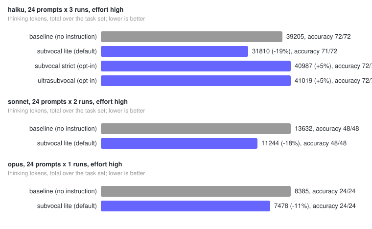

# subvocal

> Less thinking text. Same answers.

[](https://github.com/Master0fFate/subvocal/actions/workflows/ci.yml)
[](https://www.npmjs.com/package/subvocal)
[](LICENSE)
[](package.json)

Subvocal is a plugin for coding agents that cuts the tokens a model spends on
**internal reasoning** while leaving the reply exactly as it would have been.
It injects one measured sentence at the start of every session, on every
model, with no setup and no refusals. Nothing is skipped and nothing is
hidden: the model still does every step and check, it just stops narrating
them.

[Caveman](https://github.com/JuliusBrussee/caveman) shortens the *answer*.
Subvocal shortens the *thinking*. They stack.

## Measured

Fresh runs of the shipped text on 24 multi-step tasks with checkable answers,
through the Claude Code CLI at effort `high`, after the text was chosen on
separate development runs. Full method, confidence intervals and every
candidate that lost: [docs/HONEST-NUMBERS.md](docs/HONEST-NUMBERS.md).



<!-- NUMBERS:BEGIN -->
| Model | Runs | Mode | Thinking tokens (sum) | 95% CI | Per prompt (geomean) | Accuracy (off → on) | Leaked notation | Refusals |
|---|---|---|---|---|---|---|---|---|
| Haiku 5.5 | 24 × 4 | subvocal | **−16%** | −25% to −9% | −19% | 95/96 → 96/96 | 0 | 0 |
| | | ultrasubvocal | **−24%** | −33% to −16% | −26% | 95/96 → 93/96 | 0 | 0 |
| Sonnet 5.5 | 24 × 2 | subvocal | **−10%** | −32% to +18% | −3% | 48/48 → 47/48 | 0 | 0 |
| | | ultrasubvocal | **−7%** | −12% to +2% | −3% | 48/48 → 48/48 | 0 | 0 |
| Opus 5.5 | 24 × 2 | subvocal | **−17%** | −24% to −11% | −21% | 48/48 → 48/48 | 0 | 0 |
| | | ultrasubvocal | **−18%** | −25% to −9% | −17% | 48/48 → 48/48 | 0 | 0 |
<!-- NUMBERS:END -->

The number a mode reports is not the number it was fitted to: both texts
were picked on development runs (27 candidate instructions over four
rounds) and then measured again on fresh calls. The sum is what you pay; the
geometric mean of the per-prompt ratio is what a typical prompt sees, and one
very long outlier call cannot move it. Sonnet thinks a third as much as Haiku
on these tasks, so its two-run intervals are wide; read its row as "probably
a small saving", not as a measured one. Neither text has been refused on any
call, on any model.

## Contents

- [Quick start](#quick-start)
- [Install](#install)
  - [Claude Code](#claude-code)
  - [OpenAI Codex CLI](#openai-codex-cli)
  - [Cursor](#cursor)
  - [GitHub Copilot CLI](#github-copilot-cli)
  - [Gemini CLI / Antigravity CLI](#gemini-cli--antigravity-cli)
  - [OpenCode and any host that reads AGENTS.md](#opencode-and-any-host-that-reads-agentsmd)
- [Use it](#use-it)
- [How it is enforced](#how-it-is-enforced)
- [Subvocal and caveman](#subvocal-and-caveman)
- [Where the shorthand dialect went](#where-the-shorthand-dialect-went)
- [Run the benchmark yourself](#run-the-benchmark-yourself)
- [Development](#development)

## Quick start

Claude Code, one command, then start a new session:

```
/plugin install subvocal --marketplace Master0fFate/subvocal
```

That is the whole setup. Subvocal is on from the first turn. `/subvocal ultra`
switches to the more aggressive text, `/subvocal status` shows the mode,
`/subvocal off` turns it off for the session. Every other host is covered
below.

## Install

Everything needs **Node.js 18+** for the hooks. The instruction itself is
plain text. No npm dependencies, nothing is downloaded at runtime.

### Claude Code

<details open>
<summary><b>Plugin from GitHub (recommended)</b></summary>

One step on Claude Code 2.1.275 or newer:

```
/plugin install subvocal --marketplace Master0fFate/subvocal
```

Or in two steps on older versions:

```
/plugin marketplace add Master0fFate/subvocal
/plugin install subvocal@subvocal
```

From a terminal instead of inside a session (`--scope project` or
`--scope local` to install for one repository only, default is user scope):

```bash
claude plugin install subvocal --marketplace Master0fFate/subvocal
```

Start a new session afterwards. Update later from the **Installed** tab of
`/plugin`, or with `claude plugin update subvocal@subvocal`; remove with
`/plugin uninstall subvocal@subvocal`.

</details>

<details>
<summary><b>Plugin from a local clone</b></summary>

```bash
git clone https://github.com/Master0fFate/subvocal.git
```

```
/plugin marketplace add ./subvocal
/plugin install subvocal@subvocal
```

The path must start with `./` or `../`, otherwise Claude Code reads it as a
GitHub `owner/repo`.

</details>

<details>
<summary><b>Standalone, no marketplace</b></summary>

The standalone installer copies the hooks and skills into your Claude config
directory (`~/.claude`, or `$CLAUDE_CONFIG_DIR`), adds three hook entries to
`settings.json`, and backs the file up first. It is idempotent.

Without cloning:

```bash
npx subvocal
```

From a clone:

```bash
bash install.sh                                          # macOS / Linux / Git Bash
powershell -ExecutionPolicy Bypass -File install.ps1     # Windows
```

Flags, for either form:

| Flag | Effect |
|---|---|
| `--dry-run` | print what would change, change nothing |
| `--statusline` | also show a `[SUBVOCAL]` badge in the status line, if none is set |
| `--uninstall` | remove every file and settings entry the installer added |
| `--init` | instead of installing hooks, write the instruction as a fenced block into the current repository's rule files (see [OpenCode](#opencode-and-any-host-that-reads-agentsmd)) |

If you already have a status line command, chain the badge after it:

```bash
your-statusline-command; node ~/.claude/subvocal/hooks/subvocal-statusline.js
```

</details>

<details>
<summary><b>What the plugin registers</b></summary>

| Hook | Script | Job |
|---|---|---|
| `SessionStart` | `src/hooks/subvocal-activate.js` | resolve the mode, inject the instruction |
| `SubagentStart` | `subvocal-activate.js --subagent` | give subagents the same instruction |
| `UserPromptSubmit` | `src/hooks/subvocal-mode-tracker.js` | `/subvocal` mode switches and `/subvocal status`; silent on every other prompt |

All hooks fail open: on any error they print nothing and exit 0, so a broken
install never blocks a session.

</details>

### OpenAI Codex CLI

Codex hooks are on by default. This repository ships a project-level
`.codex/hooks.json` with a `SessionStart` hook that prints the instruction as
plain text, which Codex adds to the session context.

1. Clone the repository:

   ```bash
   git clone https://github.com/Master0fFate/subvocal.git
   ```

2. To use it in another project, copy `.codex/` there and point the command at
   your clone, or put the same block in `~/.codex/hooks.json` once for every
   project:

   ```json
   {
     "hooks": {
       "SessionStart": [
         {
           "matcher": "startup|resume",
           "hooks": [
             {
               "type": "command",
               "command": "node \"/path/to/subvocal/.codex/codex-sessionstart.js\"",
               "timeout": 5
             }
           ]
         }
       ]
     }
   }
   ```

3. Project hooks only run when the project's `.codex/` layer is trusted.
   Review and approve them with `/hooks` inside Codex. A changed hook is skipped
   until you re-trust it.

Codex has no `/subvocal` command; a plain "subvocal off" in a prompt does the
same job. The simplest alternative is the rule-file block, which needs no
hooks at all: run `npx subvocal --init` in the repository.

### Cursor

The `.cursor-plugin/plugin.json` manifest exposes the skills and a
`sessionStart` hook (`hooks/hooks-cursor.json`).

Local plugin install:

```bash
git clone https://github.com/Master0fFate/subvocal.git ~/.cursor/plugins/local/subvocal
```

Then restart Cursor or run **Developer: Reload Window**. Enterprise accounts
need "Allow Local Plugin Imports" turned on by an admin.

Hook only, no plugin: add this to `.cursor/hooks.json` in the project or to
`~/.cursor/hooks.json`:

```json
{
  "version": 1,
  "hooks": {
    "sessionStart": [
      {
        "type": "command",
        "command": "node \"/path/to/subvocal/src/hooks/subvocal-host-session-start.js\" cursor",
        "timeout": 10
      }
    ]
  }
}
```

### GitHub Copilot CLI

Copilot CLI reads hooks from `.github/hooks/*.json`. This repository ships
`.github/hooks/subvocal.json` with a `sessionStart` hook that returns the
instruction as `additionalContext`. To use it in another repository, copy that
file into its `.github/hooks/` directory and replace the `git rev-parse` part
of the command with the path to your clone:

```json
{
  "version": 1,
  "hooks": {
    "sessionStart": [
      {
        "type": "command",
        "bash": "node \"/path/to/subvocal/src/hooks/subvocal-host-session-start.js\" copilot",
        "powershell": "node \"C:/path/to/subvocal/src/hooks/subvocal-host-session-start.js\" copilot",
        "timeoutSec": 10
      }
    ]
  }
}
```

User-wide hooks live in `~/.copilot/hooks/`. For Copilot in VS Code, which
reads `.github/copilot-instructions.md` instead, run `npx subvocal --init` in
the repository.

### Gemini CLI / Antigravity CLI

`gemini-extension.json` loads `GEMINI.md`, which imports the skill files, and
`commands/subvocal.toml` plus `commands/ultrasubvocal.toml` add `/subvocal`
and `/ultrasubvocal`.

```bash
gemini extensions install https://github.com/Master0fFate/subvocal
gemini extensions update subvocal      # later
```

Google is moving individual Gemini CLI users to Antigravity CLI, which carries
extensions over as plugins. If the `gemini` command is gone on your machine,
install the same repository through Antigravity's plugin command.

### OpenCode and any host that reads AGENTS.md

For a host without hooks, put the instruction where the host already looks.
Inside the repository you work in:

```bash
npx subvocal --init
```

This writes a fenced block to `AGENTS.md` (created if missing), and to
`CLAUDE.md` and `.github/copilot-instructions.md` when those already exist:

```markdown
<!-- subvocal:begin -->
Keep your internal reasoning concise: a minimum draft per step, a few words each. Your reply is unaffected: write it as you normally would.
<!-- subvocal:end -->
```

Running it again changes nothing; `npx subvocal --init --uninstall` removes
the block and leaves the rest of the file alone. OpenCode, Codex, Copilot in
VS Code, Windsurf, Cline and anything else that reads `AGENTS.md` start every
session with it. Hosts that read `SKILL.md` folders can also copy
`skills/subvocal/` into their skill directory (`.opencode/skills/`,
`.agents/skills/`, `.claude/skills/`).

## Use it

### Commands

```
/subvocal            default mode: "Keep your internal reasoning concise: a minimum draft per step, a few words each. ..."
/subvocal ultra      aggressive mode, see Measured
/subvocal status     show the current mode, change nothing
/subvocal off        off for this session (also "stop subvocal", "normal mode")
```

`/ultrasubvocal` is the same as `/subvocal ultra`. `/subvocal lite` is kept
as an alias of the default for anyone upgrading from 0.1. Slash commands work
in Claude Code and Gemini CLI; on Codex, Cursor and Copilot a short plain-text
request such as "subvocal off" does the same job.

### Default mode

Sessions start in `subvocal` on every model. To change that, set one of
these, first match wins:

1. `SUBVOCAL_DEFAULT_MODE` environment variable
2. `.subvocal.json` or `.subvocal/config.json` in the project (searched upward)
3. `~/.config/subvocal/config.json` (`%APPDATA%\subvocal\config.json` on Windows)

```json
{ "defaultMode": "ultrasubvocal" }
```

| Value | Meaning |
|---|---|
| `auto` | `subvocal` on every model (default) |
| `subvocal` | same, explicitly (`lite` still works as an alias) |
| `ultrasubvocal` / `ultra` | the aggressive mode on every model |
| `manual` | start off; `/subvocal` turns it on |
| `off` | never on |

## How it is enforced

Like caveman, subvocal does not rely on the model remembering a skill:

- **SessionStart** injects the mode's sentence into the session context.
- **SubagentStart** gives subagents the same sentence.
- **UserPromptSubmit** handles `/subvocal` switches and `/subvocal status`,
  and stays silent on every other prompt, so it costs nothing per turn.
- Mode state is per session and survives resume and compaction. It lives under
  `$CLAUDE_CONFIG_DIR/.subvocal/sessions/`.

Codex, Cursor and Copilot get the SessionStart part only. Hosts without hooks
get the `--init` rule-file block instead.

## Subvocal and caveman

| | caveman | subvocal |
|---|---|---|
| What it compresses | the reply you read | the model's internal reasoning |
| What you see | terse, caveman-style answers | the same reply as without it |
| How it is measured | reply tokens | thinking tokens on tasks with checkable answers, accuracy held |
| Modes | several, with per-turn reinforcement | two plain sentences, injected once per session |
| Refusals | none | none, on every model tested |
| Together | yes: caveman's hooks trim the answer, subvocal's sentence trims the thinking in the same session | |

They are different levers on the same bill. If you only want shorter
answers, use caveman. If you want your answers untouched and the hidden
reasoning cheaper, use subvocal. If you want both, install both.

## Where the shorthand dialect went

Subvocal 0.1 started as a measured shorthand dialect for reasoning: one fact
per line, one-letter aliases, and only the operators a real tokenizer says
are cheap (`∴` costs 4 tokens, `→` costs 1). The per-token findings hold and
are useful anywhere a model writes billed text. The dialect as a thinking
instruction did not: a 12 KB specification of how to write each line gave
the model more to deliberate about than the notation saved (+5% on Haiku),
and the safeguards on Sonnet 5.5 and Opus 5.5 declined it entirely. It is
now a research document, [docs/DIALECT.md](docs/DIALECT.md), with its
measured lexicon and the pipeline that produced it (`lexicon/`, `scripts/`,
the `/subvocal-lexicon` skill). No mode injects it.

## Run the benchmark yourself

The eval calls a logged-in `claude` CLI from an empty directory with no tools,
no MCP servers and a fixed system prompt, so nothing installed on your machine
reaches any arm. Each arm's text is produced by the hook code, so it measures
what ships.

```bash
python3 evals/run.py --model haiku --sets hard,open --runs 3 --arms baseline,subvocal,ultrasubvocal --out evals/snapshots/mine.jsonl
python3 evals/report.py evals/snapshots/mine.jsonl
python3 evals/chart.py evals/snapshots/mine.jsonl --out docs/mine.svg
```

To test a different instruction without editing anything, pass it as an arm:
`--arms baseline,subvocal,mine --arm-file mine=my-instruction.md`. Real runs
cost API calls or subscription usage; details in
[evals/README.md](evals/README.md).

## Development

```
skills/             subvocal (default), ultrasubvocal, subvocal-lexicon
src/hooks/          SessionStart / UserPromptSubmit / SubagentStart / statusline hooks
installer/          standalone Claude Code installer, npm bin, --init rule blocks
evals/              eval harness, prompt sets, chart, committed snapshots
docs/               HONEST-NUMBERS.md, benchmark.svg, DIALECT.md (research)
lexicon/ scripts/   the dialect's token-measurement pipeline
.claude-plugin/ .codex/ .cursor-plugin/ .github/hooks/ hooks/ commands/ GEMINI.md
                    host integrations
tests/              node:test + unittest
```

```bash
npm test                                   # node + python tests
python3 scripts/build_lexicon.py --check   # generated lexicon block in docs/DIALECT.md is current
```

CI runs both on Ubuntu, macOS and Windows with Node 18 and 22. Project rules
are in [CLAUDE.md](CLAUDE.md); pull request expectations are in
[CONTRIBUTING.md](CONTRIBUTING.md). MIT licensed.
